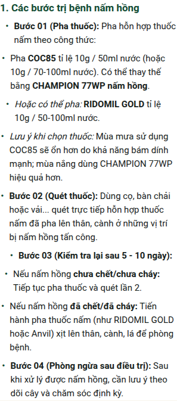
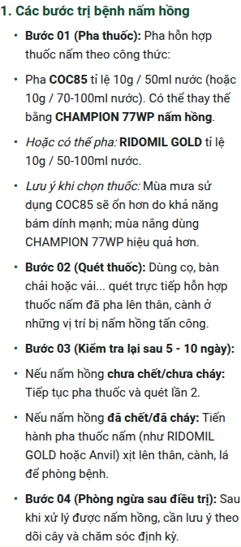

# Báo cáo kiểm thử bảo trì: căn lề Markdown trong ChatScreen

- **Ngày thực hiện:** 14/11/2026, múi giờ Việt Nam.
- **Mã lỗi:** CHAT-MD-001.
- **Loại bảo trì:** sửa lỗi trình bày giao diện.
- **Kết quả:** lỗi lệch lề giữa các bước đã được tái hiện và sửa; kiểm thử cô lập sau sửa đạt **45/45** kiểm tra trình duyệt và **3/3** kiểm thử Markdown hiện có.
- **Phạm vi xác nhận:** component hiển thị Markdown thật trên React Native Web, không phải toàn bộ ứng dụng hay BE.

## 1. Yêu cầu và điều kiện kiểm thử

Ảnh người dùng cung cấp cho thấy “Bước 01”, “Bước 02”, “Bước 03”, “Bước 04” có vị trí bắt đầu khác nhau dù cùng cấp danh sách. Mong đợi: các bước cùng cấp và phần chữ xuống hàng phải thẳng lề; tiêu đề, chữ đậm, chữ nghiêng, mã nội dòng và liên kết vẫn hiển thị bình thường.

Theo bối cảnh người dùng cung cấp, BE hiện không kết nối được. Trong checkout thực tế, thư mục `docs/` không tồn tại, nhưng `ChatScreen.tsx:67–69` vẫn tham chiếu ba ảnh `preparing_icon.png`, `processing_icon.png`, `complete_icon.png`. Vì vậy, kiểm thử được tách khỏi điểm khởi động ứng dụng, xác thực và dịch vụ mạng.

Dữ liệu Markdown được tái dựng từ ảnh, không phải phản hồi gốc lấy từ BE. Nội dung tên thuốc và liều lượng chỉ là dữ liệu kiểm thử bố cục; báo cáo không đánh giá tính đúng đắn chuyên môn của nội dung đó.

## 2. Phân tích hộp trắng và nguyên nhân

### 2.1. Luồng xử lý liên quan

```text
ChatScreen → MessageBubble
  ├─ message.role === 'user' → Text thông thường
  └─ message.role === 'assistant' → AssistantContent
       → parseAssistantContent → các block Markdown
       ├─ bullet / numbered → hàng ngang gồm marker và phần chữ
       └─ heading / paragraph → Text riêng
```

Điểm sử dụng nằm tại `src/screens/chat/ChatScreen.tsx:818`. Lỗi thực sự thuộc `src/components/AssistantContent.tsx`, nên bản sửa được đặt ở component dùng chung này. Không cần sửa logic gửi chat, lịch sử, streaming hoặc API.

### 2.2. Nguyên nhân đã được xác nhận bằng trình duyệt

Hàng danh sách có `flexDirection: 'row'`, khoảng cách giữa dấu đầu dòng và chữ là 9 px. Marker khai báo `width: 22`, nhưng chưa ngăn co chiều rộng. Trên React Native Web đang cài, phần tử Text có `flex-shrink: 1`; khi nội dung dài, cột marker bị co theo lượng chữ của từng hàng.

Vì vậy, chỉ đặt `width: 22` chưa giữ được vị trí bắt đầu chữ. Trong ca tái hiện ở chiều rộng viewport 390 px:

| Bước | Chiều rộng marker trước sửa | Vị trí chữ trước sửa | Vị trí chữ sau sửa |
| --- | ---: | ---: | ---: |
| 01 | 14,53 px | 52,53 px | 60,00 px |
| 02 | 6,47 px | 44,47 px | 60,00 px |
| 03 | 22,00 px | 60,00 px | 60,00 px |
| 04 | 8,45 px | 46,45 px | 60,00 px |

Chênh lệch lớn nhất giữa bốn bước giảm từ **15,53 px xuống 0 px**. Tọa độ được đo tương đối với viewport của sandbox, không phải đo trực tiếp trên ảnh gốc. Số liệu đầy đủ nằm trong `minh_chung/truoc-sua-browser.json` và `minh_chung/sau-sua-browser.json`.

Khi đọc mã cũng ghi nhận parser hiện chỉ hỗ trợ danh sách phẳng và dấu Markdown thụt tối đa 3 ký tự trắng. Tuy nhiên, ca ảnh đã tái hiện lỗi dù toàn bộ bullet đều được nhận diện đúng. Giới hạn parser không phải nguyên nhân trực tiếp của ca này và được giữ nguyên trong bản sửa.

### 2.3. Thay đổi bảo trì

Tại `src/components/AssistantContent.tsx`:

1. Thêm `flexShrink: 0` cho marker để giữ nguyên cột 22 px.
2. Thêm style riêng cho nội dung danh sách: `flex: 1, minWidth: 0`, để chữ chiếm phần còn lại và xuống hàng trong khung.
3. Chỉ áp dụng style mới ở nhánh bullet/numbered; heading, paragraph và định dạng nội dòng giữ cách hiển thị hiện có.

Sau sửa, khoảng thụt của phần chữ là **22 + 9 = 31 px** tính từ mép trái hàng danh sách. Phần chữ tiếp tục xuống hàng ngay tại lề đó.

Chỉ một file mã ứng dụng được sửa. Các file bổ sung nằm trong `tuanduy_bao_tri/`; không thêm dependency, không tạo ảnh giả để thay `docs/`. Các thay đổi sẵn có của người dùng trong `.gitignore`, `app.json`, `package.json`, `package-lock.json` được giữ nguyên.

## 3. Môi trường cô lập

Sandbox nằm tại `tuanduy_bao_tri/sandbox/`:

| File | Vai trò |
| --- | --- |
| `entry.jsx` | Chọn tình huống, sửa Markdown và xem kết quả bằng `AssistantContent` thật |
| `fixtures.mjs` | Sáu bộ dữ liệu: các bước từ ảnh, heading, bullet, đánh số, hồi quy định dạng, nội dung rỗng |
| `server.mjs` | Biên dịch tại chỗ và phục vụ nội bộ trên `127.0.0.1` |
| `verify.mjs` | Điều khiển trình duyệt, đo tọa độ, kiểm tra và lưu minh chứng |
| `README.md` | Hướng dẫn mở và chạy lại |

Các dependency thực tế được dùng: Node v26.13.0; React 19.3.0; React Native 0.88.1; React Native Web 0.21.4; Playwright 1.63.0; esbuild 0.28.2; TypeScript 6.0.3. Trình duyệt: Google Chrome 157.0.8103.50, chạy headless. Font Roboto được nạp từ dependency có sẵn của dự án.

Sandbox import trực tiếp `AssistantContent`, parser và theme hiện tại; không sao chép logic hiển thị thành một bản giả. Khung bong bóng bên ngoài mô phỏng các thông số liên quan của ChatScreen: `maxWidth: 90%`, padding 12 px, viền 1 px và `flexShrink: 1`. Toàn bộ ChatScreen, navigation, camera và các provider không được khởi tạo.

Kịch bản tự động chặn yêu cầu ra ngoài địa chỉ sandbox. Kết quả không có yêu cầu tới BE/dịch vụ ngoài, không có request thất bại, lỗi JavaScript hoặc console error. Các liên kết chỉ được kiểm tra hiển thị và vai trò truy cập; không mở trang đích.

## 4. Kế hoạch và kết quả kiểm thử

### 4.1. Tiêu chí chấp nhận

- Marker giữ chiều rộng 22 px, sai số đo tối đa 0,1 px.
- Chênh lệch vị trí chữ giữa các hàng cùng cấp không vượt quá 1 px.
- Các dòng xuống hàng thẳng với phần chữ đầu dòng, sai số tối đa 1 px.
- Không tràn ngang trong các dữ liệu đã chọn.
- Có đủ bốn bước của ca tái hiện; heading và định dạng nội dòng không bị mất.
- Không phụ thuộc BE hoặc `docs/` trong quá trình kiểm thử component.

### 4.2. Kiểm thử trước và sau sửa

Chạy cùng kịch bản trên các viewport **320, 360, 390, 412 và 1280 px**, chiều cao 900 px.

| Nhóm kiểm tra trình duyệt | Số kiểm tra | Trước sửa | Sau sửa |
| --- | ---: | --- | --- |
| Căn lề các bước tái dựng từ ảnh, 5 viewport | 5 | 5 FAIL | 5 PASS |
| Căn lề heading với 0–3 dấu cách, 5 viewport | 5 | 5 PASS | 5 PASS |
| Căn lề bullet `-`, `*`, `+` với 0–3 dấu cách, 5 viewport | 5 | 5 PASS | 5 PASS |
| Căn lề danh sách `1.`, `2)`, `10.`, 5 viewport | 5 | 4 FAIL, 1 PASS | 5 PASS |
| Không tràn ngang: 4 bộ dữ liệu × 5 viewport | 20 | 20 PASS | 20 PASS |
| Giữ tiếng Việt, đậm, nghiêng, code, vai trò link | 1 | PASS | PASS |
| Nội dung rỗng không tạo dòng thừa | 1 | PASS | PASS |
| Sửa nội dung theo từng phần mô phỏng streaming | 1 | PASS | PASS |
| Không có lỗi trình duyệt hoặc request thất bại | 1 | PASS | PASS |
| Không phát sinh yêu cầu ra ngoài sandbox | 1 | PASS | PASS |
| **Tổng** | **45** | **36 PASS, 9 FAIL** | **45 PASS, 0 FAIL** |

Ở bước kiểm tra chữ xuống hàng, kịch bản dùng `Range.getClientRects()` để đo vị trí chữ thực tế, không chỉ so sánh khung ngoài. Ca mô phỏng streaming cập nhật chuỗi Markdown ba lần, gồm một đoạn đang gõ dở định dạng đậm; không sử dụng SSE hay streaming thật từ BE.

### 4.3. Kiểm tra mã và hồi quy hiện có

| Kiểm tra | Kết quả | Ghi chú |
| --- | --- | --- |
| `node --import tsx --test src/components/assistantContent.test.ts` | **3/3 PASS** | Chuẩn hóa newline, heading/list/inline/link và tiếng Việt |
| TypeScript riêng `AssistantContent.tsx` cùng các import phụ thuộc | **PASS, exit 0** | Không xuất diagnostic; không dùng kết quả này để suy ra toàn app hợp lệ |
| `npm run check` toàn dự án | **FAIL, 7 diagnostic** | Cùng vị trí và loại lỗi đã thấy trước sửa; chi tiết bên dưới |
| Rà soát luồng `MessageBubble → AssistantContent` | Hoàn tất bằng đọc mã | Xác định đúng nhánh bị ảnh hưởng, không phải kiểm thử tích hợp toàn màn hình |

Kiểm tra TypeScript riêng component được chạy bằng:

```bash
./node_modules/.bin/tsc --ignoreConfig --noEmit --strict --noUncheckedIndexedAccess --jsx react-jsx --module preserve --moduleResolution bundler --target es2022 --skipLibCheck --types node,react src/components/AssistantContent.tsx
```

Bảy diagnostic sẵn có khi kiểm tra toàn dự án:

| Vị trí | Diagnostic |
| --- | --- |
| `src/components/FloatingCameraFab.tsx:36` | TS2322: kiểu ref không tương thích |
| `src/navigation/RootNavigator.tsx:55` | TS2322: kiểu ref không tương thích |
| `src/screens/chat/ChatScreen.tsx:517` | TS2322: kiểu ref không tương thích |
| `src/screens/chat/ChatScreen.tsx:535` | TS2322: kiểu ref không tương thích |
| `src/screens/chat/ChatScreen.tsx:669` | TS2322: kiểu ref không tương thích |
| `src/screens/chat/ChatScreen.tsx:689` | TS2322: kiểu ref không tương thích |
| `src/tutorial/TutorialProvider.tsx:35` | TS7031: tham số `window` ngầm có kiểu `any` |

Không có diagnostic mới thuộc component đã sửa. Không đo tỷ lệ coverage bằng công cụ; phân tích hộp trắng ở đây là đọc luồng xử lý và chọn các nhánh hiển thị liên quan để kiểm tra.

## 5. Minh chứng và cách chạy lại

Minh chứng lưu trong `tuanduy_bao_tri/minh_chung/`:

- `anh-loi-nguoi-dung.png`: bản sao ảnh nguồn.
- `truoc-sua-browser.json`, `sau-sua-browser.json`: kết quả từng kiểm tra, tọa độ, độ rộng marker, vị trí các dòng chữ và lỗi trình duyệt.
- `truoc-sua-steps-*.png`, `sau-sua-steps-*.png`: ảnh ở cả 5 viewport.
- `truoc-sua-headings-390.png`, `sau-sua-headings-390.png`: kiểm tra heading.
- `kiem-tra-trinh-duyet.log`, `kiem-tra-markdown.log`: kết quả thực thi.
- `kiem-tra-typescript-component.log`: rỗng do kiểm tra thành công, exit 0.
- `kiem-tra-typescript-toan-du-an.log`: diagnostic còn tồn tại toàn dự án.

Ảnh tái hiện trước sửa, viewport 390 px:



Ảnh cùng dữ liệu sau sửa, viewport 390 px:



Từ thư mục gốc dự án, mở sandbox tương tác:

```bash
node tuanduy_bao_tri/sandbox/server.mjs
```

Mở `http://127.0.0.1:5188`, chọn tình huống hoặc nhập Markdown. Chạy lại xác nhận tự động:

```bash
node tuanduy_bao_tri/sandbox/verify.mjs
```

Lệnh xác nhận tự chọn cổng trống, lưu lại các minh chứng `sau-sua-*`, đóng trình duyệt và dừng server khi xong; trả mã thoát 1 nếu có kiểm tra thất bại.

## 6. Đánh giá và giới hạn

**Chấp nhận bản sửa trong phạm vi component React Native Web đã kiểm tra:** lỗi trong ảnh tái hiện được trước sửa, biến mất sau sửa, các nhóm hồi quy liên quan đều đạt. Thay đổi nhỏ, tác động trực tiếp đến bố cục bullet/numbered và không sửa nội dung câu trả lời.

Chưa xác nhận chạy toàn bộ ứng dụng, luồng đăng nhập/gửi chat/lịch sử với BE thật, ảnh tiến trình trong `docs/`, hoặc hiển thị trên thiết bị Android/iOS native. Không có kết quả kiểm thử tải, bảo mật hay nội dung tư vấn chăm cây. Sandbox không tự sửa các điều kiện thiếu tài nguyên của ứng dụng chính.

Khi BE và tài nguyên ứng dụng hoạt động lại, bước nghiệm thu tích hợp còn lại là gửi một câu hỏi có câu trả lời dài trong ChatScreen thật và đối chiếu lề các bước trên thiết bị mục tiêu. Các danh sách lồng cấp, code block và số thứ tự rất dài nằm ngoài nhóm dữ liệu của lần kiểm thử này.
